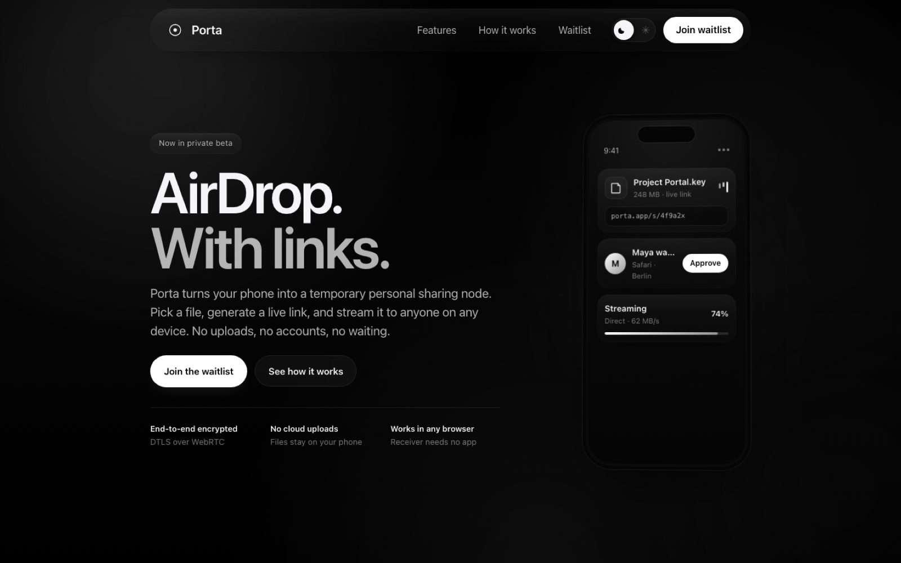

# Porta — marketing site

Porta site is the marketing and waitlist landing page for **Porta** (_AirDrop with links_), an iPhone app that shares files peer-to-peer through a temporary link.



Live demo: https://porta-site-alpha.vercel.app

Porta turns any iPhone into a temporary personal sharing node: pick a file, generate a live link, approve the incoming request, and stream the bytes directly to any browser on the planet. No cloud uploads, no accounts for receivers, no permanent hosting.

This repo hosts the public-facing website that introduces and advertises the Porta app. It is intentionally lean.

## Features

- Hero with an iPhone mock of a live link, an approval request and a streaming transfer
- Six-up feature grid and a four-step "how it works" flow
- Waitlist email capture with an App Store link
- Dark and light mode toggle
- SEO metadata (Open Graph, Twitter Cards, JSON-LD), `robots.txt`, `sitemap.xml`, PWA manifest and `public/llms.txt`

## Tech stack

- **React 18** + **TypeScript**
- **Vite 6** build + dev server
- **Node.js** 20+ recommended
- Hand-rolled CSS (no UI framework)
- True SVG **liquid glass** elements via `feDisplacementMap` + `feSpecularLighting` filters — no raster, no CSS-only fakes

## Design

- **iOS 26 Liquid Glass** visual language: refracted backdrops, pill CTAs, specular rims.
- Strict **black + white** palette. No color accents.
- Responsive down to 360px.

Every glass surface is a real composition of:

1. An SVG `<filter>` that displaces and frosts whatever is behind it.
2. A translucent white tint.
3. A gradient-stroke SVG rim.

The filter source lives in `src/components/LiquidGlassDefs.tsx` and is referenced via `backdrop-filter: url(#liquid-glass)`.

## Structure

```
src/
  App.tsx
  main.tsx
  components/
    LiquidGlassDefs.tsx   # SVG filter definitions
    Glass.tsx             # Liquid glass primitive
    Nav.tsx               # Floating pill nav
    Hero.tsx              # Hero + phone mock
    Features.tsx          # Six-up feature grid
    UserFlow.tsx          # Four-step flow
    Waitlist.tsx          # Email capture + app store link
    ThemeToggle.tsx       # Dark / light mode switch
    Footer.tsx
  styles/
    globals.css           # Imports every partial below
    reset.css
    tokens.css            # Colors, type, aurora background
    glass.css             # Liquid glass primitive styles
    layout.css            # Sections, buttons
    nav.css
    hero.css
    features.css
    flow.css
    waitlist.css
    footer.css
```

## Getting started

Requires Node.js 20+ (see `.nvmrc`).


```bash
npm install
npm run dev     # start Vite on :5173
npm run build   # typecheck + production bundle to dist/
npm run preview # preview the production build
```

## Notes on the waitlist form

The form currently persists submissions to `localStorage` under `porta.waitlist` so the UX works without a backend. Swap the inline handler in `src/components/Waitlist.tsx` for a real `fetch('/api/waitlist', …)` call when the backend is ready.

## License

The code in this repo is under the MIT License (see `LICENSE`). The Porta name and brand are not covered by it. This site promotes the Porta app — the underlying product vision lives in the main Porta monorepo.
